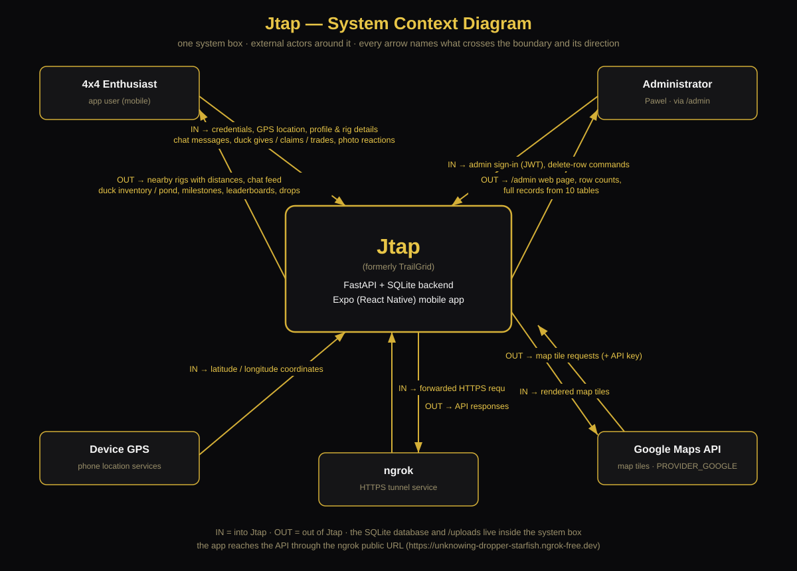
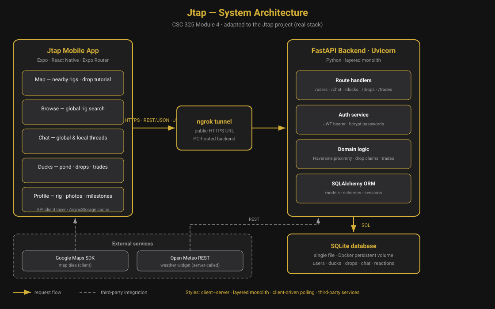

# Jtap: 4x4 Proximity Community App

An enthusiast mobile application designed for 4x4 and off-road vehicle owners to locate nearby rigs, compare builds, and request trail assistance.

## Prototype

**Figma (public link):** https://www.figma.com/design/fYy6iAItnbwtU5E939sQox/JTAP?node-id=0-1&p=f&t=Xjm7N0xS5kbk6JXT-0

The prototype is a user-centered design built around the Product Goal: *a proximity-first mobile app that gives the 4x4/off-road community a home base — showing the rigs around you, connecting owners, and turning the "ducking" tradition into a game.*

### Personas

**Primary — Mike, 34, Trail Rider.** Wheels every other weekend with a local Jeep club. Keeps running into impressive builds at trailheads but never learns who owns them or what's under the hood. Wants to see nearby rigs on a map, check build details, and coordinate rides. Android user, lives on his phone, low patience for clunky UI.

**Secondary — Jess, 27, New Owner.** Bought her first Wrangler six months ago. Less interested in wrenching, drawn in by the community game — collecting ducks, hunting location drops, building her pond. Wants the app to feel fun and welcoming, not intimidating.

**Alternate path — no rigs in range.** If the Map tab finds nobody within the radius, it shows an empty state ("No rigs nearby yet — invite riders to check in") instead of a blank map, and Mike can still use the duck feed and global chat. The app never dead-ends: every empty state offers a next action.

**Error path — location unavailable.** If Mike denies location permission or GPS is off, nearby features degrade gracefully: the Map tab explains what's missing and links straight to the permission setting, while the rest of the app (pond, marketplace, global chat) keeps working. No crash, no silent empty list.

### Context diagram




The system boundary sits around the Jtap backend (FastAPI + SQLite) and the Expo mobile app. External actors: the **4x4 Enthusiast** (app user — credentials, GPS location, profile/rig details in; nearby rigs, chat feed, ducks and milestones out), the **Administrator** (via the `/admin` panel), **Device GPS** (phone location services), **ngrok** (HTTPS tunnel exposing the PC-hosted backend), and the **Google Maps API** (map tiles).

### UI — key screens (in Figma)

Sign In (email/password + Google/Facebook/X) · Map (nearby rigs with live distances) · Browse (rig cards) · Rig Profile (build details, mods, duck showcase) · Ducks/Pond (collection) · Chat (global, local, JtapBot) · Marketplace (listings) · My Rig (profile, alerts).

### UX — primary user journey

Mike opens the app at a trailhead:
1. The **Map** tab shows nearby rigs with live distances — proximity first, no searching needed.
2. He taps a pin and views the **rig profile**: mods, specs, duck showcase.
3. He sends a **Wave**; the owner gets a push notification.
4. They connect in **local chat** and plan the next run.

Every step serves the Product Goal: see who's around you, connect, wheel together.

## Architecture

**Style: client–server, with a layered backend and a layered mobile client.**



**Interfaces:** REST/JSON over HTTPS. Every request carries a JWT bearer token in the `Authorization` header; the mobile client polls `GET /users/nearby`, `GET /chat`, and `GET /drops/active` on an interval for live data, with push arriving out-of-band via FCM.

- **Mobile client (Expo / React Native):** layered — Expo Router screens → API client module → AsyncStorage cache. Screens never touch the network directly. Tab layout: My Rig, Ducks, Browse, Map, Chat, Market.
- **Backend (FastAPI + Uvicorn, Python):** layered monolith — route handlers → Pydantic schemas → domain logic (auth, Haversine proximity, drop claims, trades, milestones) → SQLAlchemy ORM → SQLite. One deployable unit.
- **Auth:** JWT bearer tokens (bcrypt passwords); Google/Facebook/X sign-in verifies provider tokens server-side and links to existing accounts.
- **Live data:** client-driven polling (nearby rigs, chat, drops refresh on interval) — a deliberate simplification; push goes through FCM direct, not Expo.
- **Spatial engine:** Haversine great-circle distance for proximity queries.
- **Integrations:** Google Maps SDK (client map tiles), ngrok (HTTPS tunnel exposing the PC-hosted backend), Firebase Cloud Messaging (push).

**Key trade-off:** a monolithic FastAPI + SQLite backend on a single host keeps the whole system in one deployable unit with zero hosting cost — the right call for a solo developer proving the concept. The cost is operational fragility: the PC is a single point of failure, and every ngrok restart mints a new URL that must be rebuilt into the APK.

## Test Plan

- **Unit tests** — scope: isolated logic with no I/O. Tools: `pytest`. Concrete case: Haversine distance — `haversine(40.7128, -74.0060, 40.7128, -74.0060)` must return `0 m`, and two points one degree of longitude apart at the equator must return ≈ 111,195 m (±1 m). Other cases: duck rarity/award calculations, the profanity filter (leet-speak and masked forms blocked, innocent words pass), JWT creation/validation and password hashing.

- **Integration tests** — scope: API endpoints against a throwaway SQLite database; each test gets a fresh DB so tests never leak state. Tools: `pytest` + FastAPI `TestClient`. Concrete case: drop-claim radius enforcement — create a drop with `radius_m=200`, claim from 5 km away → `400` and the claimant's inventory is unchanged; claim from 50 m away → `200`, inventory gains exactly one duck, `claims_left` drops by one. Other cases: signup → login → set location → nearby returns the rig; chat post → appears in feed.

- **System / acceptance (manual)** — scope: end-to-end on a real build, the way a user experiences it. Tools: release APK installed on a physical Android phone, step-by-step checklist. Concrete case: new-rider onboarding — fresh install, sign up with a new email → lands on the Map tab, pond shows the 10 starter ducks, Send Wave on a nearby rig card delivers a notification to the other device. Other cases: sign in (email + Google), verify nearby rigs appear at a real location, claim a test drop, confirm push arrives with the app closed.
  

## Setup Instructions

### 1. Backend Setup
```bash
cd backend
python -m venv venv
source venv/bin/activate  # On Windows: venv\Scripts\activate
pip install -r requirements.txt
python seed.py            # Generates mock profiles around your area
python -m uvicorn main:app --reload --host 192.168.50.158 --port 8000
python -m uvicorn main:app --host 0.0.0.0 --port 8000 --reload

run command 
$env:REACT_NATIVE_PACKAGER_HOSTNAME="192.168.50.158"; npx expo start --clear

to avctivate android app

this will build a new apk to test
./gradlew assembleRelease

run ngrok to have a public url for local database
 ngrok http 8000 --url https://unknowing-dropper-starfish.ngrok-free.dev
 url is moved to config.js
 
gitignore file was updated to ignore database backend


the apk is standalone and will need to be installed on each users phone
the backend server needs to be running locally on a laptop 
two terminal windows are requiered to run the backend server
both terminals need to be in the C:\jeep-proximity-app\jtag\backend> directory
1 terminal will need to run ngrok
 ngrok http 8000 --url https://unknowing-dropper-starfish.ngrok-free.dev 
 2 terminal will need to run the lightSQL
 python -m uvicorn main:app --host 0.0.0.0 --port 8000 --reload

MuseAI integrated [20:21 - 2026-10-07]
